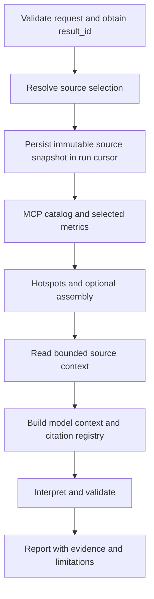

# Git source context for profile analysis

Status: historical design and four critique iterations, not the current analyzer
workflow or configuration contract. The fixed metric/hotspot flow below has been
replaced by dynamic MCP planning. See [the analyzer guide](analyzer-extension.md)
and [the integration guide](integration-guide.md) for current behavior, including
explicit local paths and planner-selected source. A subsequent GitLab HTTPS API extension with backend token storage is now
available; trusted build-manifest linkage remains future work. The original plan
below records the initial local-only scope.

## Decision

Extend the existing profile analyzer with a deterministic `GitSourceGateway`, a
source-context node, and packaged analysis instructions. A separate LLM Git agent is
not required for resolving a revision, finding candidates and reading file ranges.
The instruction document is explicitly loaded by this application; placing a skill
file in the repository alone does not provide tools or change the runtime prompt.

Initial scope is registered local Git repositories. Remote fetching, cloning, owned
object caches, worktrees, submodule traversal, LFS hydration and a separate source
investigation agent are deferred.

## Data flow and durable execution



The executor uses durable phases rather than silently resolving a branch within the
current single analysis call:

1. Validate the request and resolve any missing `result_id` or malformed options.
2. Prepare optional source access and resolve the selector to a commit.
3. Return a progress event and persist `source_snapshot` with `Store.finish_step`.
4. Analyze using that frozen snapshot, including any subsequent metric clarification.

Preparation persists a discriminated outcome: `resolved`, `unavailable` or `disabled`,
with a reason. An unavailable resolution has no invented commit identity. Replaying
the run reuses that outcome; it does not silently retry resolution against a newer
branch. In the MVP, retrying source preparation requires a new run. An explicit user
decision to continue without required source is recorded separately in the cursor.

The first accepted atomic `finish_step` is the freeze point. A retried preparation
before that point may resolve a different branch head; no accepted source binding
exists yet. Every transition merges the existing cursor and preserves corrected
options, clarification counters and source identity. Content is referenced by unique
snippet IDs rather than duplicated through nested prior reports.

A new result ID after acceptance requires a new run. Changes in the live UI do not
change an existing run's task or source snapshot. Standalone callers may prepare a
snapshot separately and pass it to analysis; durable callers own its persistence.

## Source selection and identity

Add an optional typed source request to the analysis contract. The executor obtains
repository and branch from the immutable `run.task.target`, not current UI state.
Existing tasks and reports without source data remain valid.

Source options agreed through chat can contain an exact commit, path ranges, symbol
queries and policy (`off`, `optional`, `required`). An explicit commit selection also
records the repository/branch scope for which it was agreed. If that scope differs
from the current task snapshot, ask for clarification rather than silently using a
stale commit. Do not add more fields to the project settings sidebar.

The repository string is resolved against backend-configured local repository roots.
It never grants arbitrary filesystem or network access to an LLM. Repository aliases
are stable identities and do not contain credentials.

`SourceSnapshot` records:

- Registered repository identity and requested selector.
- Full resolved commit identity and relevant tree/blob identities.
- Selection provenance: captured branch tip, user-declared commit, or a future
  trusted build-manifest mapping.
- Relation to the profile build: unverified, trusted mapping, or conflict.

Resolving a branch or finding a user-supplied SHA does not prove it produced the
profiled binary. The initial implementation has no trusted build metadata provider
and must keep that relation unverified. A future trusted mapping must explicitly
bind profile/build identity to a commit; arbitrary MCP text is not such a mapping.

Separately record symbol/source resolution: provided location, text candidate,
ambiguous or unresolved. File existence and a matching function name do not prove
the code corresponds to a sampled instruction, particularly with optimized/inlined
code or generated sources.

## Source availability and hints

The private MCP response schema has not been confirmed. Do not assume fields named
path, line, function or source. The MVP supports explicit source enrichment using
paths/ranges or symbol queries agreed in chat.

A future response adapter can produce `HotspotSourceHint` with the originating MCP
evidence ID, module, symbol and optional source location. It must read only documented
fields. Source availability has three states: unknown, present and absent. Unknown
is never converted into absent based on a guessed JSON shape.

Prefer an explicit path/range. Fixed-text search is a fallback producing candidates,
even if only one match is found. Optional mode can provide candidates as unverified
background. It must not present them as an identified hotspot implementation.

`required` means at least one explicitly specified or user-selected source range is
delivered to the model. It does not imply a verified build match. Missing paths,
ambiguous candidates or ranges that do not fit trigger a bounded clarification or an
explicit user choice to proceed without required source. Optional source failure
preserves metric analysis and is recorded as a limitation.

In model-disabled/demo execution, source fragments can still be collected as evidence.
Record `interpretation_disabled` and leave the delivery-to-model requirement unevaluated;
do not claim it was fulfilled or repeatedly ask for source merely because no model
exists. An actual missing source selection is distinct from disabled interpretation.

## Git gateway

Proposed operations:

```text
resolve_revision(repository_id, selector) -> commit identity
find_source(repository_id, commit, bounded_query) -> candidate locations
read_source(repository_id, commit, path, line_range) -> source fragment
```

The gateway reads Git objects without changing the user's working tree. Commands use
structured argv with no shell, fixed tool configuration, validated selectors and
paths, and bounded subprocess duration/output. No execution of repository code,
external diff/textconv helpers, arbitrary transports or automatic dependency actions.
Separate revision, path and fixed-string query arguments with the appropriate option
boundaries. Reject option-like revisions. Before reading a blob, check its object
type and size. Enforce output limits while consuming stdout rather than collecting
unbounded output and truncating afterward. A timeout terminates and reaps the process.

Read only regular file blobs in the selected commit tree. Do not follow symlinks or
Git links into the host filesystem or another repository. Binary files, LFS pointers,
unavailable generated files, unsupported encodings and oversized blobs are explicit
unavailable results. Build-machine absolute paths require an explicit checked mapping
to repository-relative paths; do not infer access to the build filesystem.

If pinned objects disappear from the registered repository, report unavailable. Do
not re-resolve the branch and substitute new code. An application-owned retained
object cache can be added later if this limitation becomes operationally significant.

Initial configurable source limits: five seconds, five files, eighty lines per file,
32 KiB of excerpts in total and twenty search hits. Search scope and scanned data
must also be bounded; no unconstrained whole-repository scan. Source time is a child
budget of the existing run deadline. Skip optional enrichment when too little time
remains for interpretation. Global deadline expiry still fails the run under the
existing execution policy.

## Evidence and model context

Keep existing MCP `Evidence` compatible. Add optional source snapshot/context and a
separate `SourceEvidence` list to `ProfileAnalysis`. Existing JSON schemas must be
regenerated and legacy reports must still validate.

Each source fragment contains a unique prefixed ID, repository/commit/blob identity,
actual line range, text, content hash, selection provenance, mapping status and any
originating hotspot evidence/hint. Snapshot metadata and snippet bodies have separate
ownership to prevent copies on every resume.

One `PromptContextBuilder` budgets the actual serialized model request, including
system instructions, schema, goal, metric evidence, documentation and source. Use a
configurable UTF-8 byte cap and, when available, the provider/model tokenizer. A byte
cap alone is not a guarantee of fitting every model's token context.

Preserve essential metric evidence. Remove optional source/documentation context
first when necessary. If essential evidence still does not fit, retain raw data and
return insufficient data without inventing conclusions. If required source cannot
fit, request a narrower range or explicit selection.

Only complete source lines are delivered and cited. Store the exact delivered range
and snippet hash. The citation validator accepts only IDs actually supplied to the
model, across both metric and source evidence. Full bounded raw data remains in the
run report, available through the dedicated run API, not the conversation list.

Repository code, comments and documents are quoted untrusted evidence. The trusted
instruction file is packaged with the application and explicitly loaded into the
analyzer. It distinguishes source-based observations, metric observations and causal
hypotheses; reading code does not establish measured cost or successful optimization.

## Proposed module layout

```text
integrations/
  git_source.py
profiler_analysis_agent/
  source_context.py
  context_builder.py
  instructions/
    source_analysis.md
```

Extend existing contracts, executor stages, graph wiring and citation validation.
Register instruction files in package data. No extra LLM agent or skill loader is
needed. The future source investigation agent can reuse the same gateway if needed.

## Implementation sequence and acceptance checks

1. Add optional typed source contracts, repository registration and Git gateway.
2. Add durable snapshot preparation, source context collection and prompt budgeting.
3. Integrate citations, clarifications, reports, schema export and documentation.

Use temporary real Git repositories to test branch movement, exact commits, candidate
ambiguity, missing objects/files, symlink/gitlink handling, binary files and limits.
Verify the user's working tree is unchanged and all reported ranges/hash identities
match the delivered text. Test lease redelivery and metric clarification without
re-resolving an accepted source snapshot. Test stale source options, unknown MCP
formats, source failure with successful metrics, required source clarification,
deadline expiry, context omission and rejection of omitted evidence IDs. Validate
old reports and keep the existing Web/TUI behavior.

## Four critique iterations

1. Added explicit source contracts, compatible source evidence, normalized optional
   hints and concrete read-only Git boundaries.
2. Added a durable freeze point, immutable snapshot retention, separate identity and
   symbol matching, and unavailable-object behavior without branch substitution.
3. Replaced guessed source-absence detection with explicit enrichment, clarified
   required-mode semantics, and added one model-context budget/citation registry.
4. Final critique found no remaining critical design contradictions. Added persisted
   unavailable/disabled preparation outcomes, explicit model-disabled semantics and
   streaming subprocess output limits with size checks and process termination.
